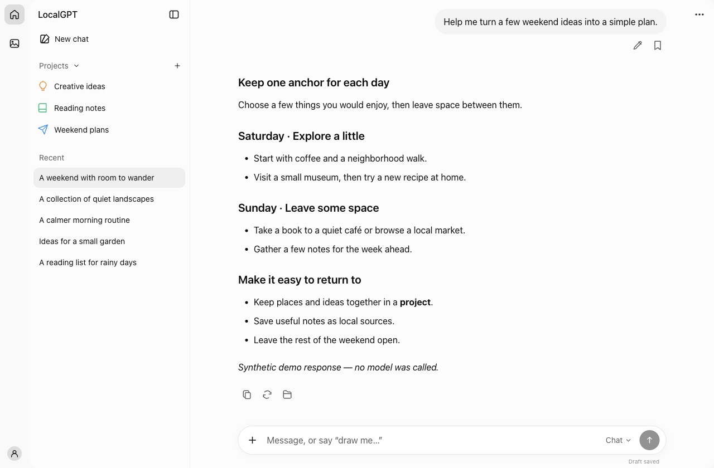
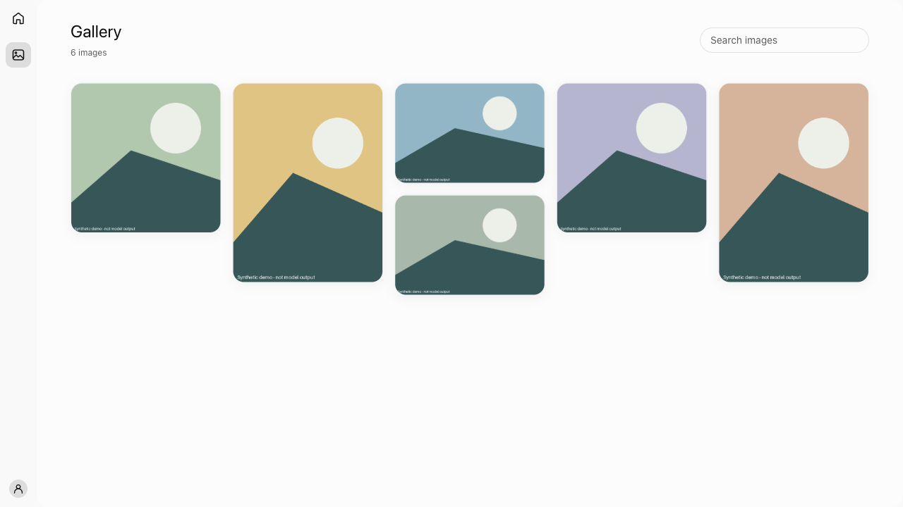

# LocalGPT

[English](README.md) · [简体中文](README.zh-CN.md)

**Your local workspace for conversations, images and projects.**
Chat with LM Studio, create images with ComfyUI, and keep conversations, files and memory on your computer.

[User guide](docs/user-guide.md) · [Latest release · 0.2.1](https://github.com/ThineLord/localgpt/releases/tag/v0.2.1) · [Agent guide](AGENTS.md)


*Actual application UI with synthetic demo content. No personal data or model-generated results are shown.*

## One workspace

- **Conversations:** streaming answers, editable prompts, stop and retry.
- **Images:** generation, editing, gallery and downloads through ComfyUI.
- **Projects and memory:** keep related chats, local files and saved context together.

English and Simplified Chinese · Light and dark themes · Local SQLite storage

<details>
<summary>View the image gallery</summary>


*The gallery preview uses deterministic test artwork, not AI-generated samples.*

</details>

## Try it locally

macOS or Linux · Python 3.10+ · No models needed for the demo

```sh
git clone https://github.com/ThineLord/localgpt.git
cd localgpt
git checkout v0.2.1
python3 -m venv .venv
.venv/bin/python -m pip install -r requirements.txt
.venv/bin/python work/chat-sidebar/build.py
.venv/bin/python work/chat-sidebar/demo.py
```

Open **http://127.0.0.1:8191/qwen-cn/**. The demo uses a temporary database and synthetic responses; stop it with Ctrl+C. Native Windows is not supported.

For real inference, follow [local service setup](docs/user-guide.md#local-services). Models and local services are separate installations. [Back up and upgrade both writers together](docs/reference/recovery.md) when updating an existing installation.

## Find your way

| Location | Contents |
| --- | --- |
| [work/chat-sidebar/](work/chat-sidebar/) | Application source and backend tests |
| [tools/](tools/) | Validation, audits and isolated demos |
| [docs/](docs/README.md) | User/agent guides, technical reference and releases |

Current application version: **0.2.1**. [Release notes](docs/releases/0.2.1.md) · [Changelog](docs/CHANGELOG.md) · [Testing](docs/testing.md)

Personal data, models and local configuration stay outside this repository. See [privacy](docs/reference/privacy.md). This is an independent application built with Python/aiohttp, SQLite and plain JavaScript.
