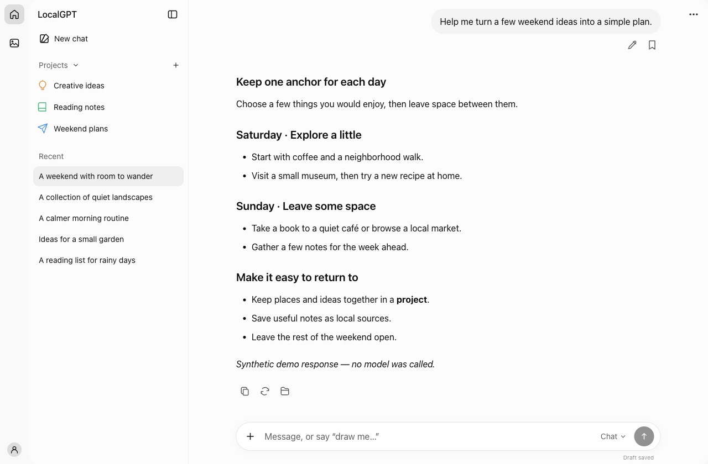
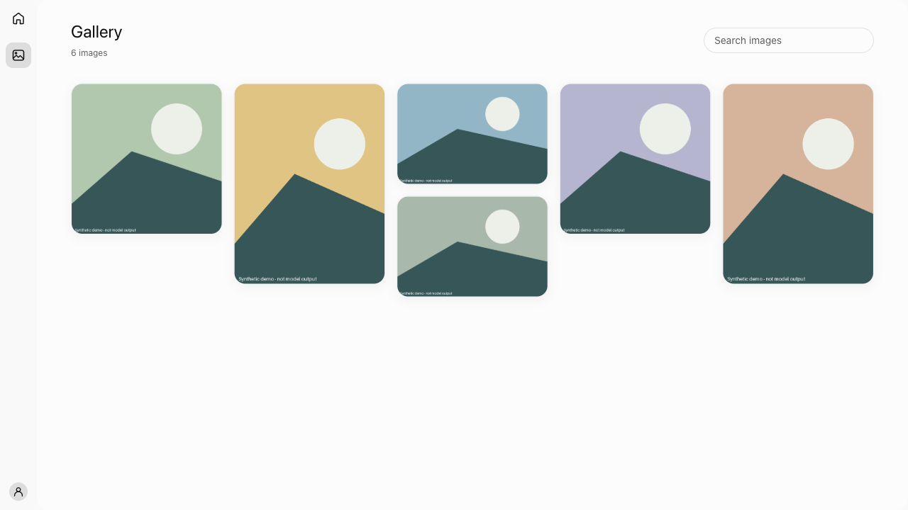

# LocalGPT

[English](README.md) · [简体中文](README.zh-CN.md)

**在本机管理对话、图像和项目的工作台。**
通过 LM Studio 对话、使用 ComfyUI 创作图像，把聊天、文件和记忆保存在自己的电脑上。

[用户指南](docs/user-guide.zh-CN.md) · [最新版本 · 0.2.1](https://github.com/ThineLord/localgpt/releases/tag/v0.2.1) · [Agent 指南](AGENTS.md)


*真实应用界面，内容来自隔离的合成演示；不包含个人数据或真实模型输出。截图使用英文界面，可切换为中文。*

## 一个工作台

- **对话：**流式回答、编辑提示词、停止和重试。
- **图像：**通过 ComfyUI 生成、编辑图像，并在图库中查看和下载。
- **项目与记忆：**集中管理相关对话、本地文件和保存的上下文。

中英文切换 · 浅色与深色主题 · 本机 SQLite 存储

<details>
<summary>查看图库界面</summary>


*图库预览使用程序绘制的测试图案，不代表 AI 生图效果。*

</details>

## 本地体验

macOS 或 Linux · Python 3.10+ · 演示无需模型

```sh
git clone https://github.com/ThineLord/localgpt.git
cd localgpt
git checkout v0.2.1
python3 -m venv .venv
.venv/bin/python -m pip install -r requirements.txt
.venv/bin/python work/chat-sidebar/build.py
.venv/bin/python work/chat-sidebar/demo.py
```

打开 **http://127.0.0.1:8191/qwen-cn/**。演示使用临时数据库和合成回答，按 Ctrl+C 停止；暂不支持原生 Windows。

实际推理见[本地服务配置](docs/user-guide.zh-CN.md#本地服务)。模型和本地服务需单独安装；已有安装升级前应[备份并协调更新两个写入端](docs/reference/recovery.md)。

## 文件导航

| 位置 | 内容 |
| --- | --- |
| [work/chat-sidebar/](work/chat-sidebar/) | 应用源码和后端测试 |
| [tools/](tools/) | 验证、审计和隔离演示工具 |
| [docs/](docs/README.md) | 用户／Agent 指南、技术参考与版本说明 |

当前应用版本：**0.2.1**。[版本说明](docs/releases/0.2.1.zh-CN.md) · [更新记录](docs/CHANGELOG.md) · [测试方法](docs/testing.zh-CN.md)

个人数据、模型和本地配置不进入仓库，详见[隐私说明](docs/reference/privacy.md)。这是一个独立应用，使用 Python/aiohttp、SQLite 和原生 JavaScript 构建。
